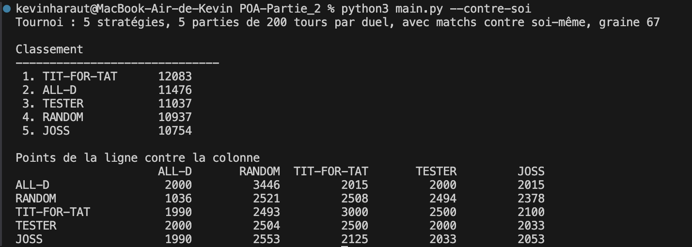
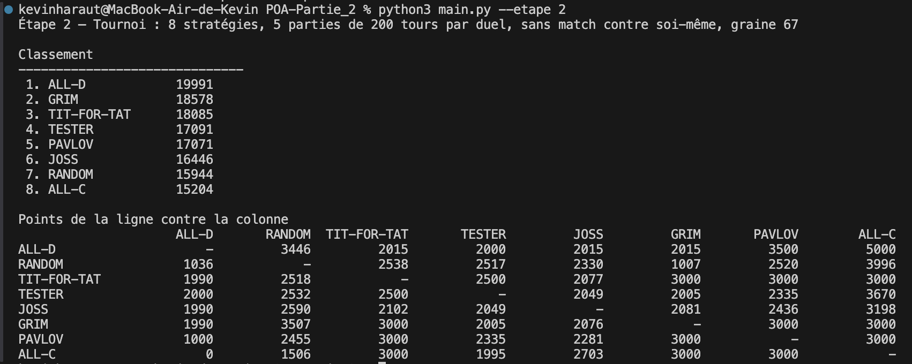
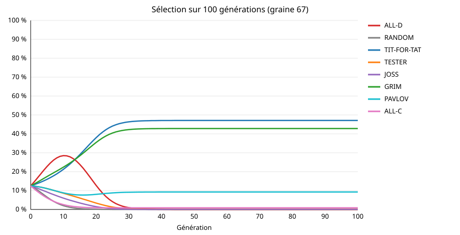
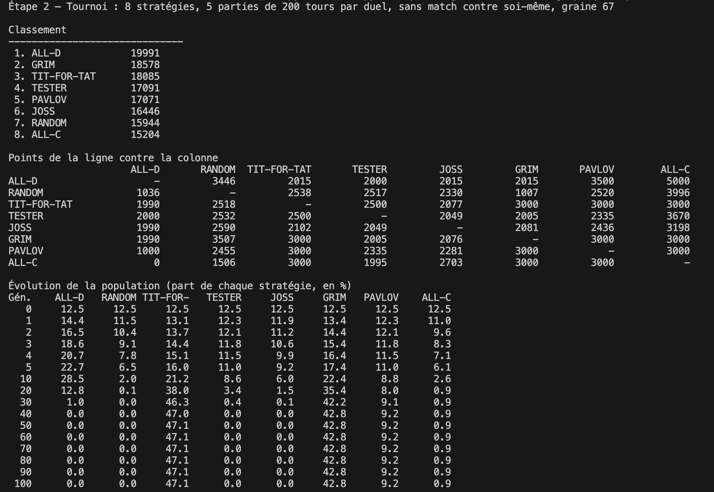

# Journal de bord — Tournoi du dilemme du prisonnier itéré

HAI716I Projet 2 (partie 1) — Kevin HARAUT

J'ai tenu ce journal au fil du travail, dans l'ordre où les choses se sont passées. J'y
note ce que j'ai fait, ce que j'ai observé, ce que j'avais prévu et ce qui ne s'est pas
passé comme prévu. Chaque étape renvoie au commit correspondant dans l'historique git.

---

## Comment j'ai organisé le tournoi

Je suis parti du tournoi d'Axelrod tel qu'il est présenté dans le cours, et j'ai gardé ses
règles le plus fidèlement possible, pour pouvoir comparer mes résultats aux siens.

| Ce que j'ai fixé | Valeur | Pourquoi |
|---|---|---|
| Les gains | 3 chacun si on coopère tous les deux, 2 chacun si on trahit tous les deux, 5 pour celui qui trahit et 0 pour celui qui se fait avoir | C'est la matrice du cours et du sujet. |
| Tours par partie | 200 | Comme Axelrod. |
| Parties par duel | 5 | Comme Axelrod. Jouer plusieurs fois permet d'atténuer la chance pour les stratégies qui jouent au hasard. |
| Qui joue contre qui | Chaque stratégie affronte chacune des autres | Comme le mini-tournoi du cours, sans match contre soi-même. |
| Qui gagne | Celle qui a le plus de points au total | Ce n'est pas le nombre de duels gagnés qui compte, mais la somme des points. |
| La graine | 67 | Pour que les résultats soient exactement les mêmes à chaque lancement (mes tout premiers essais utilisaient 42). |
| Le hasard de JOSS | 10 % | Le cours dit qu'elle trahit « une fois sur dix » ; je l'ai pris comme une chance sur dix. |

Le nombre de tours et le nombre de parties ne sont pas figés dans le code : on peut les
changer au lancement (`--tours` et `--parties`). Par défaut, le programme utilise 5 parties
de 200 tours, comme Axelrod, et c'est avec ces valeurs que j'ai joué tous les tournois
de ce journal.

Quelques choix que j'ai faits en écrivant le programme :

- **Une stratégie, c'est juste une règle qui regarde le passé.** Elle reçoit la liste de
  ses coups et de ceux de l'adversaire, et répond « je coopère » ou « je trahis ». Elle
  n'a pas de mémoire cachée : tout ce qu'elle sait, elle le lit dans l'historique. C'est
  plus simple à tester, et il n'y a rien à remettre à zéro entre deux parties.
- **Les deux joueurs choisissent en même temps.** Chacun ne voit que les tours déjà joués,
  jamais le coup que l'autre est en train de choisir.
- **Tout le hasard passe par un seul tirage au sort**, préparé au début avec la graine.
  Aucune stratégie ne tire au sort de son côté : sinon, la graine ne suffirait plus à
  rejouer exactement le même tournoi.

---

## Les stratégies

### Celles du cours

**ALL-D** trahit à chaque tour, sans exception. Elle vient de la théorie des jeux : c'est la
stratégie « rationnelle » qu'on obtient en raisonnant à rebours depuis le dernier tour,
comme le présente le cours. Elle devrait bien s'en sortir contre
celles qui coopèrent sans jamais punir, comme RANDOM. Personne ne peut la battre en duel,
mais face à quelqu'un qui riposte (TFT, TESTER, JOSS), elle tombe dans un échange de
trahisons à 2 points par tour.

**RANDOM** joue à pile ou face, sans regarder ce qui s'est passé avant. Dans le tournoi
d'Axelrod, elle servait de témoin, pour comparer les autres programmes au pur hasard. Elle n'a pas
vraiment d'adversaire préféré : elle gagne gros seulement quand elle trahit quelqu'un qui
coopère. Contre ALL-D, elle se fait avoir chaque fois qu'elle coopère, et elle ne punit
jamais.

**TIT-FOR-TAT (TFT)** coopère au premier tour, puis copie ce que l'adversaire a fait au
tour d'avant. Elle a été proposée par Anatol Rapoport au tournoi d'Axelrod de 1980, qu'elle
a gagné alors que c'était le programme le plus court de tous. Avec une stratégie coopérative,
 elles coopèrent tout le match. Contre ALL-D,
elle perd le premier tour puis trahit comme elle. Contre celles qui trahissent par
surprise (JOSS, TESTER), elle tombe dans un engrenage : « tu me trahis, je te le rends ».
Une propriété m'a frappé : **TFT ne bat jamais son adversaire en duel**, au mieux elle fait
match nul.

**JOSS** joue comme TFT, mais quand elle devrait coopérer, elle trahit en douce une fois
sur dix. Elle porte le nom de son auteur, Johann Joss, qui l'a soumise au tournoi de 1980 :
c'est une TFT « rusée », qui essaie de grappiller quelques points. Elle profite des naïfs qui
 ne punissent pas. Contre TFT ou contre une autre JOSS,
c'est le drame : une trahison lance l'engrenage, et une deuxième fait basculer tout le
monde dans la trahison permanente.

**TESTER** commence par trahir pour « tester » l'adversaire. Si l'adversaire riposte, elle
se met à jouer comme TFT ; sinon, elle l'exploite en répétant coopérer, coopérer, trahir.
Elle fait partie des programmes des tournois d'Axelrod présentés dans le cours ; j'ai suivi
la définition du cours, qui diffère un peu d'autres descriptions (voir mon
impasse plus bas).
Elle devrait bien s'en sortir contre les naïfs. Mais contre tous ceux qui ripostent, sa
trahison du premier tour se retourne contre elle : comme elle ne s'excuse jamais,
l'engrenage ne s'arrête plus.

### Celles que j'ai ajoutées (étape 2)

**GRIM** coopère tant que l'adversaire ne l'a jamais trahie. À la première
trahison, elle trahit jusqu'à la fin, sans jamais pardonner. Elle vient de la théorie des
jeux répétés, où on l'appelle la « gâchette implacable » (*grim trigger*) : c'est la menace
de punition la plus sévère possible. Une version de cette idée, le programme de James
Friedman, participait déjà au tournoi de 1980. Avec les gentilles, elle
coopère comme TFT. Contre RANDOM, elle devrait faire mieux que TFT : dès la première
trahison, elle cesse de lui faire confiance et l'exploite. En revanche, une seule trahison
de JOSS ou de TESTER suffit à tout gâcher. Je l'ai ajoutée parce que c'est **TFT sans le
pardon** : la comparer à TFT montre ce que pardonner rapporte, ou coûte.

**PAVLOV** coopère au premier tour. Ensuite, si le tour précédent lui a rapporté beaucoup
(3 ou 5 points), elle refait la même chose ; s'il lui a rapporté peu (0 ou 2), elle change.
Elle a été rendue célèbre par Nowak et Sigmund en 1993, qui ont montré
qu'elle fait mieux que TFT dans une population où les joueurs se trompent.
Avec les gentilles, elle coopère tout le match. Son atout, c'est de savoir réparer une
erreur avec quelqu'un qui pense comme elle : si deux PAVLOV se trahissent par accident,
elles changent toutes les deux et repartent sur la coopération. Son point faible, c'est
ALL-D : après un tour où tout le monde trahit, elle se dit « ça ne marche pas » et revient
à la coopération… pour se faire avoir à nouveau. Je l'ai choisie parce qu'elle pardonne,
mais d'une façon très différente de TFT.

**ALL-C** coopère toujours, quoi qu'il arrive. C'est la stratégie la plus naïve possible,
l'opposée d'ALL-D ; on la retrouve dans les travaux qui ont prolongé ceux d'Axelrod, comme
exemple de coopérateur qui ne se défend jamais. Avec les gentilles, tout va bien. Avec
toutes les autres, elle se fait exploiter, parce qu'elle ne punit jamais. Je ne l'ai pas
ajoutée pour qu'elle gagne, mais comme une **proie** : elle permet de voir qui profite d'un
pigeon, et comment la composition de la population change le classement.

---

## Le journal, jour après jour

### Vendredi 13 novembre 2026, pendant la séance

#### 1. La première partie — commit `feat: Moteur de partie et matrice de gains -Ajout de 2 strategies: ALL-D et TIT-FOR-TAT`

J'ai commencé par le plus simple : faire jouer une partie entre deux stratégies. Pour la
tester, je n'avais besoin que de deux règles très simples, ALL-D et TFT. J'ai vérifié les
scores à la main :

```
TFT  contre TFT  : 600 / 600    elles coopèrent 200 tours, 200 × 3
TFT  contre ALL-D: 398 / 403    TFT se fait avoir au 1er tour, puis 199 tours de trahisons
ALL-D contre ALL-D: 400 / 400   200 × 2
```

Tout correspondait. Et déjà une première chose m'a frappé : TFT perd son duel contre ALL-D,
de 5 points seulement.

**Une commande pour regarder une partie de près.** Au début, je faisais ces vérifications
avec de petits bouts de code à part, que personne d'autre ne pouvait relancer facilement.
En fin de projet, j'ai ajouté au programme une option `--duel`, qui fait exactement ce
travail de base : faire jouer deux stratégies l'une contre l'autre, sans tournoi. Elle
affiche le score de chaque partie, puis les coups de la première partie, 50 tours par
ligne. Regarder un duel tour par tour, c'est ce qui m'a permis tout au long du travail de
comprendre les résultats : l'engrenage de TFT contre JOSS, PAVLOV qui se fait reprendre
par ALL-D, etc. Avec cette option, n'importe qui peut le refaire.

Commande : `python3 main.py --duel TIT-FOR-TAT ALL-D --parties 1`

```
Partie 1 : TIT-FOR-TAT 398 - 403 ALL-D
Total    : TIT-FOR-TAT 398 - 403 ALL-D

Coups de la partie 1 (C = coopère, D = trahit)
Tours   1 à  50
  TIT-FOR-TAT  CDDDDDDDDDDDDDDDDDDDDDDDDDDDDDDDDDDDDDDDDDDDDDDDDD
  ALL-D        DDDDDDDDDDDDDDDDDDDDDDDDDDDDDDDDDDDDDDDDDDDDDDDDDD
```

On retrouve le calcul fait à la main : TFT coopère au premier tour et se fait avoir, puis
elle copie ALL-D et les deux trahissent jusqu'à la fin.

#### 2. RANDOM — commit `feat: strategie RANDOM`

Avec RANDOM, le hasard entre en jeu, et donc la question de la graine. J'ai vérifié deux
choses : qu'avec la même graine, on obtient exactement la même partie, et qu'avec une
autre graine, on obtient une autre partie. Sur 10 000 coups, RANDOM coopère bien une fois
sur deux (49,9 %).

```
graine 42 : 506 / 501
graine 42 : 506 / 501   la même partie, exactement
graine 7  : 513 / 508   une autre partie
```

Là encore, TFT perd de 5 points. J'ai compris pourquoi : chaque trahison qu'elle subit,
elle la rend au tour suivant, donc les comptes s'équilibrent, sauf la toute dernière
trahison, qu'elle n'a pas le temps de rendre. TFT ne peut donc jamais battre personne.

#### 3. JOSS — commit `feat: strategie JOSS`

JOSS m'a montré pour la première fois ce que j'ai appelé ensuite « l'engrenage ». Voici les
40 premiers coups d'une partie contre TFT (C = coopère, D = trahit) :

```
JOSS: CDCDCDCDCDCDDDDDDDDDDDDDDDDDDDDDDDDDDDDD
TFT : CCDCDCDCDCDCDDDDDDDDDDDDDDDDDDDDDDDDDDDD
```

Au 2e tour, JOSS trahit par surprise. TFT le lui rend, JOSS le lui rend, et ainsi de suite :
elles alternent. Puis, au 13e tour, JOSS retrahit au mauvais moment, et les deux se
retrouvent à trahir en même temps jusqu'à la fin. JOSS « gagne » son duel 409 à 404, mais
les deux ont perdu environ 200 points par rapport à deux TFT qui coopèrent tranquillement.
Vouloir gratter un peu coûte très cher, à tout le monde.

#### 4. TESTER — commit `feat: stratégie TESTER`

**Ma première impasse.** J'ai d'abord écrit TESTER d'après une description trouvée en
dehors du cours (celle de Hofstadter) : après la riposte de l'adversaire, TESTER
« s'excusait » en coopérant une fois, puis jouait comme TFT. En relisant les diapositives,
j'ai vu que la version du cours est différente : **pas d'excuse**, et quand l'adversaire ne
riposte pas, elle répète coopérer, coopérer, trahir. J'ai corrigé avant de committer,
puisque le sujet demande les stratégies du cours.

Ce petit détail change tout contre TFT :

| | Avec l'excuse | Version du cours |
|---|---|---|
| TESTER contre TFT | 599 / 599, elles finissent par coopérer | **500 / 500**, l'engrenage dure toute la partie |
| TESTER contre TESTER | 599 / 599 | **400 / 400**, elles trahissent jusqu'au bout |

Sans pardon, une seule trahison au départ suffit à détruire toute la coopération. Le cours
le dit d'ailleurs : « pardonner permet de repartir après un mauvais départ ».

Pour vérifier la partie « exploitation » de TESTER, j'ai dû l'opposer à une stratégie qui
ne riposte jamais (ALL-C, que j'ai ajoutée plus tard) : contre elle, TESTER marque 734 à
399. Contre la population du cours, ça n'arrive jamais, puisque tout le monde riposte.

#### 5. Le tournoi — commit `feat: tournoi tous contre tous et classement`

Une fois les cinq stratégies prêtes, j'ai écrit le tournoi : chaque stratégie affronte
chacune des autres sur 5 parties, et on additionne les points.

Pour être sûr de mon programme, je l'ai d'abord testé sur le mini-tournoi du cours (deux
TFT et un ALL-D, 10 tours). J'ai retrouvé exactement les chiffres de la diapositive :
48, 48 et 46.

Puis j'ai lancé un premier vrai tournoi, avec la graine 42 :

```
1. ALL-D        9467
2. TIT-FOR-TAT  9056
3. TESTER       9042
4. JOSS         8721
5. RANDOM       8390
```

Première surprise : ce n'est pas TFT qui gagne. En regardant le détail des duels, j'ai vu
qu'ALL-D gagne surtout grâce à RANDOM, qu'elle exploite bien plus que n'importe qui
d'autre. Et TFT n'arrive à coopérer pleinement avec personne : elle est prise dans
l'engrenage avec TESTER et finit par tout trahir avec JOSS.

### Dimanche 15 novembre 2026

#### 6. Le programme principal et le choix de la graine — commit `feat: main.py (graine 67, classement, tableau des duels) et option --contre-soi`

J'ai ensuite écrit le programme qu'on lance en ligne de commande : il fixe la graine, fait
jouer le tournoi, puis affiche le classement et le détail des duels.

J'en ai profité pour choisir la graine définitive du projet : **67** au lieu de 42. Le choix
est arbitraire, ce qui compte c'est qu'elle soit fixée et notée. J'ai vérifié que le
classement est le même avec les deux.

Commande : `python3 main.py --seed 67`


```
Classement
------------------------------
 1. ALL-D             9476
 2. TIT-FOR-TAT       9100
 3. TESTER            9051
 4. JOSS              8716
 5. RANDOM            8421
```

Pour être sûr que ce n'était pas un coup de chance, j'ai relancé avec dix graines
différentes. ALL-D gagne à chaque fois. Seules TFT et TESTER s'échangent parfois la 2e et
la 3e place, à quelques dizaines de points près.

**Une piste en cherchant pourquoi TFT perd.** Dans le cours, le mini-tournoi se joue sans
match contre soi-même. J'ai ajouté une option `--contre-soi` pour voir si ça changeait quelque chose.

Commande : `python3 main.py --seed 67 --contre-soi`



```
Classement
------------------------------
 1. TIT-FOR-TAT      12083
 2. ALL-D            11476
 3. TESTER           11037
 4. RANDOM           10937
 5. JOSS             10754
```

Ça change tout : **TFT passe première**, et ça se vérifie avec les dix graines.

#### La question de l'étape 1 : TIT-FOR-TAT gagne-t-il ?

**Non, pas dans mon tournoi.** ALL-D gagne (9476 points contre 9100 pour TFT), et c'est le
cas avec toutes les graines que j'ai essayées.

**TFT n'a personne avec qui coopérer.** TFT ne gagne jamais un duel : elle gagne en
accumulant des points avec ceux qui coopèrent avec elle.

**ALL-D a une proie : RANDOM.** Contre RANDOM, ALL-D marque plus de points que
contre n'importe qui d'autre. C'est ce seul duel qui lui donne l'avance : contre ceux qui
ripostent, elle ne fait pas mieux que 2 points par tour.

**Pourquoi c'est différent de 1980.** En 1980, la plupart des programmes ne trahissaient 
jamais les premiers, et TFT avait beaucoup de partenaires avec qui coopérer. Ici, aucune 
des quatre autres ne coopère vraiment avec elle.
En 1980, chaque programme jouait aussi contre son double : c'est exactement ce que montre mon essai
avec `--contre-soi`, où TFT passe première. Contre une copie d'elle-même, TFT coopère tout
le match, alors qu'ALL-D contre ALL-D ne fait que s'échanger des trahisons. Ce seul match
suffit à renverser le classement.

**Ce que j'en retiens :** TFT n'est pas la meilleure stratégie dans l'absolu. Elle gagne
quand elle est entourée de stratégies qui coopèrent ; dans une petite population agressive,
c'est celle qui exploite le mieux le plus faible qui l'emporte.

---

## Étape 2 : de nouvelles stratégies

#### 7. GRIM — commit `feat: stratégie GRIM`

J'ai commencé par GRIM. En la faisant jouer contre chacune des autres, deux
choses ressortent. Contre RANDOM, elle marque 678 points par partie, bien plus que TFT
(environ 500) : dès que RANDOM trahit une fois, GRIM arrête de lui faire confiance et
l'exploite jusqu'au bout. Mais contre TESTER et JOSS, une seule trahison au début suffit,
et la partie entière se passe à trahir.

```
GRIM contre TFT    : 600 / 600   elles coopèrent tout le match
GRIM contre RANDOM : 678 / 218   GRIM ne pardonne pas, et ça paie
GRIM contre TESTER : 401 / 401   la trahison du premier tour gâche tout
```

Mon pari avant de relancer le tournoi : GRIM devrait finir haut, peut-être même devant
ALL-D, puisqu'elle exploite RANDOM presque aussi bien qu'elle tout en coopérant avec TFT.

#### 8. PAVLOV — commit `feat: stratégie PAVLOV`

En écrivant PAVLOV, j'ai remarqué une simplification : avec les gains du cours, on gagne
« beaucoup » (3 ou 5) exactement quand l'adversaire a coopéré. La règle revient donc à : si
l'autre a coopéré, je refais pareil ; s'il a trahi, je change.

Les tests m'ont surpris. Avec les gentilles, PAVLOV coopère tout le match. Mais contre
ALL-D, c'est la pire de toutes : elle alterne sans arrêt (coopérer, trahir, coopérer…) et ne
marque que 200 points, deux fois moins que TFT. Après un tour où tout le monde trahit, elle
se dit que ça ne marche pas et retente la coopération, pour se faire avoir à nouveau.

```
PAVLOV contre TFT    : 600 / 600
PAVLOV contre ALL-D  : 200 / 700
PAVLOV contre TESTER : 467 / 467
```

Mon pari : sans erreurs de jeu, PAVLOV devrait finir derrière TFT, à cause de ses pertes
contre ALL-D. Son vrai atout ne devrait se voir qu'avec du bruit.

#### 9. ALL-C — commit `feat: stratégie ALL-C`

ALL-C, c'est le pigeon. Contre les gentilles, elle coopère et marque 600 points, comme
n'importe qui. Contre toutes celles qui trahissent, elle se fait plumer : 0 point contre
ALL-D, qui en marque 1000. Ce qui m'a intéressé, c'est **qui profite du pigeon** : seulement
celles qui trahissent (ALL-D, RANDOM, TESTER, JOSS). Les gentilles ne gagnent rien de plus
contre ALL-C que contre n'importe quelle autre gentille. Et TESTER, pour la première fois,
peut enfin utiliser sa règle d'exploitation.

Mon pari : ALL-C sera dernière, et elle va surtout aider ALL-D à rester en tête.

#### 10. Le tournoi avec les huit stratégies — commit `feat: option --etape 2 (population élargie)`

J'ai ajouté une option pour choisir la population : les 5 stratégies du cours, ou les 8.

Commande : `python3 main.py --etape 2`



```
Classement
------------------------------
 1. ALL-D            19991
 2. GRIM             18578
 3. TIT-FOR-TAT      18085
 4. TESTER           17091
 5. PAVLOV           17071
 6. JOSS             16446
 7. RANDOM           15944
 8. ALL-C            15204
```

Avec dix graines, le trio de tête est toujours ALL-D, GRIM, TFT, et ALL-C est toujours
dernière. Même en ajoutant les matchs contre soi-même, ALL-D reste première cette fois.

| Rang | Étape 1 | Étape 2 |
|---|---|---|
| 1 | ALL-D | ALL-D |
| 2 | TIT-FOR-TAT | **GRIM** |
| 3 | TESTER | TIT-FOR-TAT |
| 4 | JOSS | TESTER |
| 5 | RANDOM | **PAVLOV** |
| 6 | | JOSS |
| 7 | | RANDOM |
| 8 | | **ALL-C** |

Les cinq stratégies du cours gardent le même ordre entre elles ; les trois nouvelles
viennent s'intercaler.

**Mes paris.** GRIM finit bien haut, deuxième, mais pas devant ALL-D : à moitié réussi.
PAVLOV finit derrière TFT, comme prévu. Et ALL-C est bien dernière, en faisant surtout le
bonheur d'ALL-D.

**ALL-D vit de ses proies.** En regardant d'où viennent ses points, c'est flagrant : à elles
trois, ALL-C, PAVLOV et RANDOM lui rapportent près de 12 000 points sur ses 20 000. Pour en
avoir le cœur net, j'ai relancé le tournoi en retirant seulement ALL-C :

```
python3 -c "
import random
from moteur import tournoi, classement
from main import POPULATION_ELARGIE as P
pop = {n: s for n, s in P.items() if n != 'ALL-C'}
for n, s in classement(tournoi(pop, rng=random.Random(67))[0]): print(f'{n:12} {s}')
"

GRIM         15573
TIT-FOR-TAT  15106
ALL-D        14991
...
```

**Sans ALL-C, ALL-D tombe à la 3e place et c'est GRIM qui gagne.** Une seule stratégie naïve
dans la population suffit à faire gagner la plus méchante.

**Pourquoi GRIM passe devant TFT.** Contre toutes les autres, elles font exactement les
mêmes scores. Toute la différence vient de RANDOM : GRIM arrête de lui faire confiance dès
la première trahison et l'exploite, alors que TFT lui pardonne chaque fois qu'elle recoopère.
Pardonner à quelqu'un qui ne tient jamais compte de la punition, ça ne rapporte rien.

**Ce que j'en retiens :** comme à l'étape 1, le classement dépend de qui est dans la
population. Ajouter des gentilles aide TFT, mais ajouter une proie aide encore plus ALL-D.
Ce sont celles qui savent punir (GRIM, TFT, ALL-D) qui s'en sortent le mieux, et celles
qui ne punissent pas, ou mal, servent de nourriture aux autres.

---

## Étape 3 : modifier le tournoi

### Ce que j'ai choisi de tester, et pourquoi

En regardant les résultats des étapes 1 et 2, deux choses m'ont marqué.

D'abord, presque tout se joue au moment où quelqu'un trahit. TFT perd des points contre
JOSS et TESTER parce qu'elle rend coup pour coup et ne sort plus de l'engrenage. GRIM ne
pardonne jamais. PAVLOV, elle, a une façon bien à elle de se rattraper. Je me suis donc
demandé : que se passe-t-il si les joueurs se trompent ? C'est ce que permet le
**bruit** : de temps en temps, un coup part à l'envers. C'est une bonne façon de vérifier
ce que dit le cours, qu'il vaut mieux savoir pardonner.

Ensuite, j'ai vu qu'ALL-D gagne surtout parce qu'elle a des proies (ALL-C, RANDOM, PAVLOV).
Quand j'ai retiré ALL-C, elle est tombée à la 3e place. D'où l'idée de la **sélection** :
si les stratégies qui gagnent se multiplient et celles qui perdent disparaissent, ALL-D
finira par manquer de victimes.

J'ai laissé de côté l'horizon inconnu, parce qu'aucune de mes stratégies ne regarde à quel
tour on en est : je m'attends à ce que ça ne change presque rien. Et je n'ai pas changé la
matrice des gains, pour pouvoir comparer directement avec ce que j'ai déjà obtenu.

### Modification 1 : le bruit

#### Comment je vais m'y prendre

Je garde exactement le tournoi de l'étape 2 (les 8 stratégies, la graine 67, 5 parties de
200 tours), pour que la seule différence soit le bruit.

À chaque tour, chaque joueur a 5 % de chances que son coup soit inversé : il voulait
coopérer et il trahit, ou l'inverse. C'est la valeur proposée dans le sujet. Le point
important, c'est que **personne ne sait qu'il y a eu une erreur**. L'adversaire voit
simplement une trahison, et il réagit comme si elle était voulue.

5 %, ça paraît peu, mais sur 200 tours, ça fait en moyenne une dizaine d'erreurs par joueur
et par partie.

#### Ce que je pense qu'il va se passer (écrit avant de coder)

**GRIM, à mon avis, va tomber.** Elle ne pardonne jamais : dès que l'adversaire
trahit, même par erreur, elle trahit jusqu'à la fin. Ses propres erreurs ne la déclenchent
pas directement, puisqu'elle ne regarde que les coups de l'autre. Mais l'autre, lui, voit
une trahison et répond souvent par une trahison : c'est cette réponse qui fait basculer
GRIM. Seul un adversaire qui ne réagit jamais, comme ALL-C, lui pardonne ses erreurs. Et comme les erreurs arrivent
vite, même deux stratégies gentilles qui jouent ensemble ne devraient coopérer qu'une
dizaine de tours avant que tout parte en vrille. Elle était 2e à l'étape 2 ; je la vois
passer dans la seconde moitié du classement.

**TFT devrait souffrir aussi, mais moins.** Une erreur la lance dans le même engrenage
qu'avec JOSS : je trahis, tu me le rends, je te le rends… Mais une deuxième erreur peut
aussi bien la faire sortir de cet engrenage. Elle devrait rester au milieu.

**PAVLOV devrait être la grande gagnante parmi les gentilles.** Quand deux PAVLOV se
trompent, elles se retrouvent toutes les deux à trahir, se disent « ça ne marche pas »,
changent en même temps et recommencent à coopérer. En deux tours, c'est réparé. Je pense
qu'elle va passer devant TFT.

**ALL-D devrait rester en tête.** Elle n'a jamais coopéré avec
personne, donc elle n'a rien à perdre. Pendant ce temps, les autres vont perdre une partie
de la coopération qui les faisait gagner.

**RANDOM et ALL-C ne devraient presque pas bouger.** RANDOM joue déjà au hasard, une
erreur de plus ou de moins ne change rien. ALL-C devrait rester en bas du classement.

En résumé, je m'attends à : ALL-D toujours première, PAVLOV qui monte devant TFT, et GRIM
qui descend.

#### Ce qui s'est vraiment passé

Côté code, le bruit a été assez simple à ajouter : une fois que chaque stratégie a choisi
son coup, le programme tire au sort et, 5 fois sur 100, le retourne. J'ai juste fait
attention à ne rien changer quand il n'y a pas de bruit, pour que les résultats des étapes
1 et 2 restent les mêmes. J'ai vérifié, c'est bien le cas.

Commande : `python3 main.py --etape 2 --bruit 0.05`


```
Classement
------------------------------
 1. ALL-D            20097
 2. GRIM             20004
 3. JOSS             17045
 4. TIT-FOR-TAT      16749
 5. TESTER           16697
 6. PAVLOV           16090
 7. RANDOM           16077
 8. ALL-C            12008
```

Quand j'ai vu ce classement, j'ai d'abord pensé que j'étais tombé sur une mauvaise graine.
GRIM deuxième, PAVLOV sixième : c'était presque l'inverse de ce que j'avais écrit. Alors
j'ai relancé avec dix graines différentes. Le résultat ne bouge pas : ALL-D et GRIM restent
en tête à chaque fois (GRIM passe même première une fois), JOSS est toujours troisième, et
PAVLOV finit toujours dans le bas du classement. Ce n'est donc pas un accident.

| | Sans bruit (étape 2) | Avec 5 % de bruit |
|---|---|---|
| 1 | ALL-D | ALL-D |
| 2 | GRIM | GRIM |
| 3 | TIT-FOR-TAT | **JOSS** |
| 4 | TESTER | TIT-FOR-TAT |
| 5 | PAVLOV | TESTER |
| 6 | JOSS | **PAVLOV** |
| 7 | RANDOM | RANDOM |
| 8 | ALL-C | ALL-C |

#### Ce que j'avais prédit, et où je me suis trompé

**GRIM, c'est ma plus grosse erreur.** J'étais persuadé qu'elle allait s'effondrer, et
c'est elle qui progresse le plus. Je n'avais vu que la moitié de l'histoire. C'est vrai
qu'avec les stratégies gentilles, elle se fâche vite et perd la coopération. Mais une fois
fâchée, GRIM se met à jouer exactement comme ALL-D… et dans ce tournoi, jouer comme ALL-D,
c'est justement ce qui rapporte le plus. Le bruit lui donne en quelque sorte une excuse : il
suffit qu'ALL-C se trompe une seule fois pour que GRIM se retourne contre elle, et ALL-C,
qui ne se défend jamais, se fait ensuite exploiter jusqu'à la fin. Elle perd un peu avec
ses amies, mais elle gagne beaucoup sur les plus faibles.

**PAVLOV, je me suis trompé sur le résultat, mais pas sur la raison.** Je pensais qu'elle
monterait, et elle recule. Pourtant, ce que j'avais imaginé est vrai : elle sait très bien
réparer une erreur. Pour en avoir le cœur net, j'ai relancé le tournoi en laissant chaque
stratégie jouer aussi contre son double (`--contre-soi`). Deux PAVLOV s'entendent bien
mieux que deux TFT ou deux GRIM : quand l'une se trompe, elles se retrouvent toutes les
deux à trahir, changent ensemble et repartent sur de bonnes bases. PAVLOV contre son double
fait 2900 points, contre 2568 pour TFT et 2055 pour GRIM
(commande : `python3 main.py --etape 2 --bruit 0.05 --contre-soi`).

Le problème, c'est que dans le tournoi normal, une stratégie ne joue jamais contre
elle-même. PAVLOV ne rencontre donc jamais quelqu'un qui pardonne de la même façon qu'elle.
Avec les autres, sa gentillesse se retourne contre elle. Le pire, c'est face à GRIM : une
fois GRIM fâchée, PAVLOV revient sans arrêt vers la coopération, en espérant que ça
reparte, et se fait punir à chaque fois. Elle s'en sort presque aussi mal que contre ALL-D.

**TFT, là j'avais vu juste.** Les erreurs la font tomber dans son engrenage habituel, « tu
me trahis, je te le rends », et elle perd une partie de la coopération qui la faisait
vivre. Elle recule d'une place, sans s'effondrer.

**ALL-D, à moitié juste.** Elle reste bien première, mais je pensais qu'elle prendrait plus
d'avance. C'est l'inverse : GRIM revient presque à sa hauteur. Je n'avais pas vu que le
bruit allait, en quelque sorte, fabriquer une deuxième ALL-D.

**JOSS, la vraie surprise.** Je n'avais rien prévu pour elle, et elle passe de la 6e à la 3e
place. Sans bruit, sa petite trahison surprise suffisait à la brouiller pour de bon avec
TFT ou TESTER. Avec le bruit, tout le monde fait des erreurs, et ces brouilles finissent
aussi par s'arranger par hasard. Son défaut, trahir de temps en temps, devient banal :
quand tout le monde se trompe, plus personne ne la remarque vraiment. Avec GRIM, c'est
elle qui gagne le plus de points grâce au bruit.

**ALL-C, comme prévu, reste dernière**, et elle perd beaucoup : chaque erreur qu'elle fait 
fâche GRIM.

#### Ce que j'en retiens

Je pensais que le bruit allait récompenser les stratégies qui pardonnent. Dans mon tournoi,
c'est presque l'inverse : il récompense celles qui **savent être méchantes au bon moment**,
tant qu'il reste des proies à exploiter (ALL-C, PAVLOV, RANDOM).
PAVLOV pardonne pour rien : entourée de stratégies qui ne pardonnent pas de la même façon,
elle ne peut pas en profiter.

C'est la même leçon qu'aux étapes 1 et 2 : on ne peut pas dire qu'une stratégie
est bonne ou mauvaise sans savoir avec qui elle joue.


### Modification 2 : la sélection

#### L'idée

Jusqu'ici, chaque stratégie était présente une seule fois, quoi qu'il arrive. Avec la
sélection, je veux voir ce qui se passe si la population **évolue** : les stratégies qui
marquent beaucoup de points se multiplient, celles qui en marquent peu deviennent de plus
en plus rares. On peut l'imaginer comme une ville où les comportements qui réussissent
sont copiés par de plus en plus de monde, génération après génération.

#### Comment je vais m'y prendre

- Je pars de la population de l'étape 2 (les 8 stratégies), toutes à égalité : chacune
  représente 1/8 de la population au départ.
- Je fais d'abord jouer le tournoi une fois, comme d'habitude, pour savoir combien chaque
  stratégie marque contre chaque autre. Ces résultats ne changent pas d'une génération à
  l'autre : ce qui change, c'est **qui on rencontre le plus souvent**.
- À chaque génération, le score d'une stratégie est la moyenne de ce qu'elle marque contre
  les autres, en tenant compte de leur part dans la population. Si ALL-C ne représente plus
  que 1 % de la population, la gagner ne rapporte presque plus rien.
- Comme dans les tournois, une stratégie ne joue pas contre sa propre espèce, sauf si
  j'active `--contre-soi`.
- La part de chaque stratégie à la génération suivante est proportionnelle à sa part
  actuelle multipliée par son score : mieux que la moyenne, elle grandit ; moins bien,
  elle rétrécit.
- Je fais tourner 100 générations, avec la graine 67 et sans bruit, pour pouvoir comparer
  avec l'étape 2.

#### Ce que je pense qu'il va se passer (écrit avant de coder)

**Au début, ALL-D va grossir.** Dans la population de départ, elle a beaucoup de proies :
ALL-C, PAVLOV et RANDOM. C'est ce qui la faisait gagner à l'étape 2, et au départ rien n'a
changé.

**ALL-C et RANDOM vont disparaître en premier.** Ce sont elles qui marquent le moins.
ALL-C se fait exploiter par tous ceux qui trahissent, et RANDOM ne construit jamais rien
avec personne.

**Ensuite, ALL-D va se retrouver sans victimes.** 
Une fois ALL-C et RANDOM disparues, ALL-D ne rencontre plus que des stratégies qui lui
rendent coup pour coup, et elle n'arrive plus à faire mieux que 2 points par tour. Pendant
ce temps, les gentilles (GRIM, TFT, PAVLOV) coopèrent entre elles à 3 points par tour. Je
pense qu'ALL-D va monter, puis redescendre, et finir par disparaître.

**PAVLOV va souffrir au début.** Tant qu'ALL-D est nombreuse, PAVLOV se fait exploiter
(elle revient sans cesse à la coopération). Si elle tient assez longtemps pour voir ALL-D
disparaître, elle pourrait se stabiliser, car entre gentilles tout le monde fait le même
score.

**JOSS et TESTER vont décliner lentement.** Elles ne coopèrent jamais complètement avec
personne : leurs petites trahisons les empêchent de profiter d'un monde de gentilles.

**À la fin, il ne restera que des gentilles**, surtout GRIM et TFT. Je pense que GRIM aura
la plus grosse part, parce qu'elle a mieux profité des proies au début (elle exploitait
RANDOM, contrairement à TFT). Mais une fois entre gentilles, elles font toutes le même
score, donc la population devrait se figer.


#### Ce qui s'est vraiment passé

Pour la sélection, j'ai réutilisé le tournoi tel quel : je le fais jouer une fois, je garde
les points de chaque duel, puis je fais évoluer les parts de la population génération
après génération.

Commande : `python3 main.py --etape 2 --generations 100 --graphique captures/selection.svg`





```
Évolution de la population (part de chaque stratégie, en %)
Gén.    ALL-D   RANDOM TIT-FOR-   TESTER     JOSS     GRIM   PAVLOV    ALL-C
   0     12.5     12.5     12.5     12.5     12.5     12.5     12.5     12.5
   5     22.7      6.5     16.0     11.0      9.2     17.4     11.0      6.1
  10     28.5      2.0     21.2      8.6      6.0     22.4      8.8      2.6
  20     12.8      0.1     38.0      3.4      1.5     35.4      8.0      0.9
  30      1.0      0.0     46.3      0.4      0.1     42.2      9.1      0.9
  40      0.0      0.0     47.0      0.0      0.0     42.8      9.2      0.9
 100      0.0      0.0     47.1      0.0      0.0     42.8      9.2      0.9
```

L'histoire se lit très bien sur la courbe. Pendant les dix premières générations, ALL-D
s'envole : elle passe de 12,5 % à presque 30 % de la population, en se nourrissant de ses
proies. Puis, au moment où RANDOM et ALL-C deviennent rares, elle s'effondre aussi vite
qu'elle est montée. Vers la génération 30, elle a presque disparu. Pendant ce temps, TFT et
GRIM montent régulièrement, se croisent, et finissent par se partager la population.
À partir de la génération 40, plus rien ne bouge.

J'ai relancé avec d'autres graines : l'histoire est exactement la même à chaque fois.

#### Ce que j'avais prédit, et où je me suis trompé

**ALL-D qui monte puis disparaît : c'est exactement ce qui s'est passé**, et c'est le
résultat dont je suis le plus content. Il montre bien ce qu'on soupçonnait depuis l'étape
2 : ALL-D ne gagne pas parce qu'elle est forte, mais parce qu'elle a des victimes. Quand
les victimes disparaissent, elle ne rencontre plus que des stratégies qui lui rendent ses
trahisons, et elle ne tient plus face à celles qui coopèrent entre elles.

**RANDOM disparaît bien parmi les premières**, comme prévu.

**ALL-C, en revanche, ne disparaît pas complètement**, et je ne l'avais pas vu venir. Elle
chute très vite au début, mais il en reste un peu moins de 1 % jusqu'au bout. En y
réfléchissant, c'est logique : une fois qu'ALL-D, RANDOM, TESTER et JOSS ont disparu,
plus personne n'est là pour l'exploiter. Au milieu des gentilles, elle coopère comme tout
le monde et marque autant qu'elles. Elle ne gagne plus de terrain, mais elle n'en perd
plus non plus.

**PAVLOV, j'avais vu juste.** Elle souffre tant qu'ALL-D est nombreuse (elle descend
jusqu'à environ 8 %), puis remonte un peu et se stabilise autour de 9 % une fois ALL-D
partie.

**JOSS et TESTER déclinent bien, mais plus vite et plus complètement que je le pensais.**
J'avais écrit « lentement » ; en fait, elles ont totalement disparu vers la génération 40.
Leurs petites trahisons les empêchent de profiter du monde de gentilles qui se met en place.

**Le monde final est bien un monde de gentilles, mais c'est TFT qui le mène, pas GRIM.**
C'est mon erreur principale. J'avais raisonné sur l'avantage de GRIM contre RANDOM, mais
RANDOM disparaît très vite : dès la génération 10, il n'en reste que 2 %. L'avantage de
GRIM s'évapore donc presque tout de suite. Par contre, TESTER reste présente plus
longtemps, et c'est là que TFT fait la différence : contre TESTER, TFT tombe dans
l'engrenage où l'on alterne les trahisons, ce qui rapporte quand même 2,5 points par tour,
alors que GRIM, elle, se met à trahir pour de bon et n'en marque que 2. Ce petit écart,
répété pendant les générations où TESTER est encore là, suffit pour que TFT passe devant.

**La population se fige, comme prévu.** Une fois que seules les gentilles restent, elles
coopèrent toutes entre elles et marquent exactement le même score. Plus personne n'a
d'avantage sur personne, donc les parts ne bougent plus.

#### Ce que j'en retiens

Dans un tournoi où chacun ne joue qu'une fois, ALL-D peut
gagner en exploitant les plus faibles. Mais si on laisse le temps faire son œuvre, ce
succès détruit ce dont elle se nourrit, et elle disparaît. Les stratégies qui coopèrent,
elles, se renforcent mutuellement et finissent par occuper toute la place.

C'est finalement TIT-FOR-TAT qui l'emporte. Cela rejoint ce que dit le cours : TFT ne
prospère que s'il y a assez de stratégies « qui pensent comme elle » ; la sélection est
justement ce qui finit par les lui donner.
