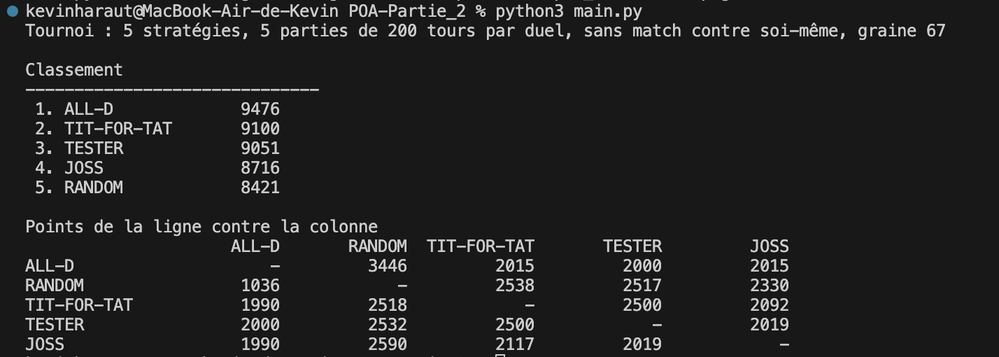
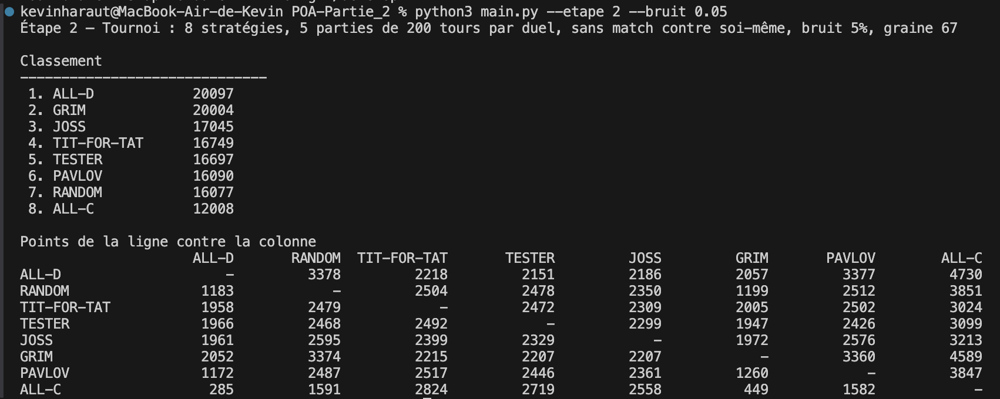

# Journal de bord — Tournoi du dilemme du prisonnier itéré

HAI716I Projet 2 (partie 1) — Kevin HARAUT

Ce journal est tenu au fur et à mesure du travail. Les entrées sont dans l'ordre
chronologique ; chaque étape renvoie au commit correspondant.

---

## Protocole

| Paramètre | Valeur | Raison |
|---|---|---|
| Matrice des gains | CC = 3/3, CD = 0/5, DC = 5/0, DD = 2/2 | Celle du cours et du sujet. |
| Tours par partie | 200 | Format d'Axelrod |
| Parties par duel | 5 | Format d'Axelrod |
| Appariement | Chaque paire de stratégies distinctes, une fois | Pas de match contre soi-même |
| Score | Somme des points sur tous les duels | Le meilleur total gagne, pas le nombre de duels gagnés. |
| Graine aléatoire | 67 | Un seul générateur `random.Random(graine)` sert à tout le tournoi. Les essais des entrées 1 à 5 ont été faits avec la graine 42, avant le choix définitif (voir entrée 6). |
| Probabilité de trahison de JOSS | 10 % | « remplace C par D une fois sur dix ». |

### Choix de conception

- **Une stratégie = une fonction** `strategie(mes_coups, coups_adverses, rng) -> "C" | "D"`.
  Elle déduit tout de l'historique, sans état caché : rien à réinitialiser entre deux
  parties, et chaque stratégie se teste isolément.
- **Simultanéité** : au tour *t*, chaque stratégie ne reçoit que les coups des tours
  0 à *t-1*. Le coup de l'adversaire au tour *t* est calculé sans connaître le sien.
- **Hasard centralisé** : le moteur passe le même `rng` à toutes les stratégies.
  Aucune stratégie n'appelle `random.random()` directement, sinon la graine ne
  contrôlerait plus tout.

---

## Fiches des stratégies

### Population de base 

#### ALL-D
- **Règle :** trahit à tous les tours.
- **Devrait bien jouer contre :** les stratégies qui coopèrent sans punir (RANDOM).
- **Devrait mal jouer contre :** rien ne la bat en duel, mais face à des stratégies qui ripostent (TFT, TESTER, JOSS) elle tombe en D/D à 2 points par tour.

#### RANDOM
- **Règle :** C ou D avec une chance sur deux, sans regarder l'historique.
- **Devrait bien jouer contre :** personne en particulier ; elle gagne ses 5 points quand elle trahit un coopérateur.
- **Devrait mal jouer contre :** ALL-D, qui l'exploite chaque fois qu'elle coopère. Elle ne punit jamais.

#### TIT-FOR-TAT (TFT)
- **Règle :** C au premier tour, puis rejoue le coup de l'adversaire au tour précédent.
- **Devrait bien jouer contre :** les stratégies coopératives (coopération totale à 3 points par tour).
- **Devrait mal jouer contre :** ALL-D (perd le premier tour, puis D/D), et les stratégies qui trahissent par surprise (JOSS, TESTER).
- **Propriété :** elle ne bat jamais son adversaire en duel, elle fait match nul.

#### JOSS
- **Règle :** joue comme TFT, mais quand elle devrait coopérer, trahit avec une probabilité de 10 %.
- **Devrait bien jouer contre :** les coopérateurs naïfs. Elle exploite parfois sans être punie.
- **Devrait mal jouer contre :** TFT et elle-même : une seule trahison déclenche un écho, et une deuxième fait basculer en D/D permanent.
- **Interprétation :** « une fois sur dix » est lu comme une probabilité de 10 %.

#### TESTER
- **Règle :** D au premier tour. Si l'adversaire riposte (a déjà joué D), joue TFT ; sinon répète le motif C, C, D.
- **Devrait bien jouer contre :** les coopérateurs naïfs qui ne punissent jamais (exploités un tour sur trois).
- **Devrait mal jouer contre :** toutes les stratégies réactives. Sa sonde du premier tour déclenche une riposte ; comme elle ne s'excuse pas, l'écho de représailles ne s'arrête jamais.

### Nouvelles stratégies (étape 2)

#### GRIM 
- **Règle :** coopère tant que l'adversaire n'a jamais trahi ; dès sa première trahison, trahit jusqu'à la fin de la partie.
- **Devrait bien jouer contre :** les coopérateurs (coopération totale comme TFT) et RANDOM (elle l'exploite à partir de sa première trahison, contrairement à TFT qui continue à lui pardonner).
- **Devrait mal jouer contre :** les stratégies qui trahissent une seule fois par erreur ou par sonde (JOSS, TESTER) : elle ne pardonne jamais, donc D/D jusqu'à la fin. Elle sera très fragile au bruit (étape 3).
- **Raison de l'ajout :** c'est TFT sans pardon. La comparer à TFT montre ce que rapporte le pardon.

#### PAVLOV 
- **Règle :** coopère au premier tour. Ensuite, si le tour précédent a rapporté beaucoup (3 ou 5 points), rejoue le même coup ; sinon (0 ou 2 points), change de coup.
- **Devrait bien jouer contre :** les coopératives (coopération totale), et elle-même même après une erreur : deux PAVLOV qui se trahissent par accident tombent en D/D, changent toutes les deux et reviennent à C/C.
- **Devrait mal jouer contre :** ALL-D. Après un D/D (2 points, « perdu »), elle repasse à C et se fait reprendre : elle alterne C et D, soit 1 point par tour en moyenne, deux fois moins que TFT.
- **Raison de l'ajout :** une stratégie qui pardonne, mais d'une façon différente de TFT.

#### ALL-C
- **Règle :** coopère à tous les tours, quoi que fasse l'adversaire.
- **Devrait bien jouer contre :** les stratégies gentilles (TFT, GRIM, PAVLOV, elle-même) : coopération totale, 600 par partie.
- **Devrait mal jouer contre :** toutes celles qui trahissent, car elle ne punit jamais : ALL-D (0 point), RANDOM, TESTER (seule à subir le motif C, C, D) et JOSS.
- **Raison de l'ajout :** Elle sert à voir quelles stratégies profitent d'un pigeon, et donc comment la composition de la population change le classement.

---

## Chronologie

### Vendredi 13 novembre 2026 — séance

#### 1. Moteur d'une partie — commit `feat: moteur de partie et matrice des gains (ALL-D, TFT)`

Matrice des gains et fonction `jouer_partie`. Pour la tester : ALL-D et TFT.

Vérification à la main :

```
TFT  vs TFT  : (600, 600)    200 tours × 3
TFT  vs ALL-D: (398, 403)    tour 1 : 0/5, puis 199 × 2
ALL-D vs ALL-D: (400, 400)   200 × 2
```

Première observation : TFT perd son duel contre ALL-D, de 5 points.

#### 2. RANDOM — commit `feat: stratégie RANDOM`

```
graine 42 : (506, 501)
graine 42 : (506, 501)    -> même graine, même partie : reproductible
graine 7  : (513, 508)    -> autre graine, autre partie
part de C sur 10000 coups : 0.499
```

TFT perd encore de 5 points contre RANDOM : chaque trahison subie est rendue au tour
suivant, sauf la dernière. TFT ne peut jamais battre son adversaire.

#### 3. JOSS — commit `feat: stratégie JOSS`

```
JOSS vs TFT  : (409, 404)
JOSS vs ALL-D: (398, 403)
JOSS vs JOSS : (403, 403)
TFT  vs TFT  : (600, 600)   (pour comparer)

40 premiers coups de JOSS contre TFT :
JOSS: CDCDCDCDCDCDDDDDDDDDDDDDDDDDDDDDDDDDDDDD
TFT : CCDCDCDCDCDCDDDDDDDDDDDDDDDDDDDDDDDDDDDD
```

**Écho des représailles :** la trahison surprise du tour 2 lance une alternance C/D ;
la deuxième trahison (tour 13) fait basculer les deux en D/D jusqu'à la fin.
JOSS « gagne » son duel 409 à 404, mais les deux perdent environ 200 points par rapport
à deux TFT qui coopèrent.

#### 4. TESTER — commit `feat: stratégie TESTER`

(La version corrigée ci-dessous a été écrite avant le commit : seule la version du cours
figure dans l'historique git.)

**Impasse :** la première version suivait la description de TESTER donnée par Hofstadter :
après la riposte, TESTER « s'excuse » en coopérant une fois, puis joue TFT ; sinon C, C,
puis D un tour sur deux. En relisant les diapositives du cours, la définition
attendue est différente : **pas d'excuse**, et le motif d'exploitation est **C, C, D**.
J'ai corrigé pour suivre le cours, puisque le sujet impose les stratégies du cours.

L'écart change beaucoup le résultat contre TFT :

| | Version Hofstadter (avec excuse) | Version du cours |
|---|---|---|
| TESTER vs TFT | 599 / 599 (coopération après l'excuse) | **500 / 500** (écho C/D permanent) |
| TESTER vs TESTER | 599 / 599 | **400 / 400** (D/D permanent) |

Version du cours, 12 premiers coups :

```
vs TFT    score (500, 500)  TESTER DCDCDCDCDCDC | TFT CDCDCDCDCDCD
vs ALL-C  score (734, 399)  TESTER DCCDCCDCCDCC | ALL-C CCCCCCCCCCCC
vs ALL-D  score (400, 400)  TESTER DDDDDDDDDDDD | ALL-D DDDDDDDDDDDD
vs TESTER score (400, 400)  TESTER DDDDDDDDDDDD | TESTER DDDDDDDDDDDD
vs JOSS   score (401, 401)  TESTER DCDDDDDDDDDD | JOSS CDDDDDDDDDDD
```

(ALL-C, « coopère toujours », n'est pas une stratégie du tournoi : c'est un adversaire
jetable pour vérifier la branche C, C, D, qui ne se déclenche jamais contre la population
du cours puisque toutes ripostent.)

Leçon : sans pardon, une seule trahison initiale suffit à détruire la coopération.

#### 5. Tournoi tous contre tous — commit `feat: tournoi tous contre tous et classement`

Fonction `tournoi` : chaque paire de stratégies distinctes (`itertools.combinations`)
joue 5 parties ; on cumule les scores. Fonction `classement` : tri décroissant.

**Validation sur le mini-tournoi du cours** — 2 TFT + 1 ALL-D, 10 tours, 1 partie :

```
Mini-tournoi du cours : [('TFT1', 48), ('TFT2', 48), ('ALL-D', 46)]
```

Deux lancements avec la graine 42 donnent le même résultat.

**Premier essai du tournoi d'Axelrod** (graine 42, 5 parties × 200 tours) :

```
1. ALL-D        9467
2. TIT-FOR-TAT  9056
3. TESTER       9042
4. JOSS         8721
5. RANDOM       8390

               ALL-D  RANDOM TIT-FOR  TESTER    JOSS
ALL-D              -    3440    2015    2000    2012
RANDOM          1040       -    2497    2485    2368
TIT-FOR-TAT     1990    2487       -    2500    2079
TESTER          2000    2510    2500       -    2032
JOSS            1992    2593    2104    2032       -
```

(Lecture : ligne = stratégie, colonne = adversaire, case = points de la ligne sur les 5 parties.)

Premières observations, à approfondir avec `main.py` :
- **ALL-D gagne grâce à RANDOM** : 3440 points contre lui, environ 1400 de plus que contre
  n'importe qui d'autre. Contre les autres, elle plafonne vers 2000 (D/D).
- **TFT n'a aucun partenaire coopératif** : écho permanent avec TESTER (2500), D/D avec
  JOSS (2079). Elle ne coopère pleinement avec personne.

### Dimanche 15 novembre 2026

#### 6. Point d'entrée `main.py` — commit `feat: main.py (graine 67, classement, tableau des duels) et option --contre-soi`

`main.py` lit les options (`--seed`, `--parties`, `--tours`), crée **un seul**
`random.Random(graine)`, lance le tournoi et affiche le classement et le tableau des duels.

**Choix de la graine :** les essais précédents utilisaient la graine 42. J'ai choisi
la graine **67** comme graine officielle du projet (valeur par défaut de `main.py`).
Le choix est arbitraire : ce qui compte, c'est qu'elle soit fixée et notée. Avec 42
comme avec 67, l'ordre du classement est identique dans les deux formats ; seuls les
duels contre RANDOM et JOSS varient de quelques dizaines de points.

Commande : `python3 main.py --seed 67`



```
Tournoi : 5 stratégies, 5 parties de 200 tours par duel, sans match contre soi-même, graine 67

Classement
------------------------------
 1. ALL-D             9476
 2. TIT-FOR-TAT       9100
 3. TESTER            9051
 4. JOSS              8716
 5. RANDOM            8421

Points de la ligne contre la colonne
                     ALL-D       RANDOM  TIT-FOR-TAT       TESTER         JOSS
ALL-D                    -         3446         2015         2000         2015
RANDOM                1036            -         2538         2517         2330
TIT-FOR-TAT           1990         2518            -         2500         2092
TESTER                2000         2532         2500            -         2019
JOSS                  1990         2590         2117         2019            -
```

**Robustesse :** relancé avec les graines 1 à 10, ALL-D est **premier dans les 10 cas**.
Seul l'ordre TIT-FOR-TAT / TESTER (2e et 3e) change selon la graine : leurs scores ne
diffèrent que de quelques dizaines de points.

**Découverte : le match contre soi-même.** En cherchant pourquoi TFT ne gagne pas, j'ai
remarqué que le cours fait jouer le mini-tournoi sans match contre soi (CM4 p.68), alors
que dans le tournoi d'Axelrod de 1980, chaque programme affrontait aussi son double. J'ai
ajouté l'option `--contre-soi` pour tester les deux formats (on ne compte alors que le
score d'une des deux copies).

Commande : `python3 main.py --seed 67 --contre-soi`


```
Tournoi : 5 stratégies, 5 parties de 200 tours par duel, avec matchs contre soi-même, graine 67

Classement
------------------------------
 1. TIT-FOR-TAT      12083
 2. ALL-D            11476
 3. TESTER           11037
 4. RANDOM           10937
 5. JOSS             10754

Points de la ligne contre la colonne
                     ALL-D       RANDOM  TIT-FOR-TAT       TESTER         JOSS
ALL-D                 2000         3446         2015         2000         2015
RANDOM                1036         2521         2508         2494         2378
TIT-FOR-TAT           1990         2493         3000         2500         2100
TESTER                2000         2504         2500         2000         2033
JOSS                  1990         2553         2125         2033         2053
```

Avec les graines 1 à 10 : TIT-FOR-TAT est **premier dans les 10 cas**.

#### Question de l'étape 1 : TIT-FOR-TAT gagne-t-il ?

**Non, pas au format du cours** : ALL-D gagne (9476 contre 9100 pour TFT, graine 67),
et c'est le cas avec toutes les graines testées. Le résultat diffère de 1980 pour trois raisons.

**1. TFT n'a personne avec qui coopérer.** TFT ne gagne jamais un duel : elle prospère
seulement en coopérant à 3 points par tour avec d'autres stratégies coopératives
(CM4 p.69). En 1980, une grande partie des programmes étaient « gentils » (ne trahissent
jamais en premier). Ici, aucune des quatre autres stratégies ne lui permet de coopérer
durablement :
- ALL-D trahit toujours ;
- RANDOM trahit une fois sur deux ;
- TESTER trahit au premier tour et ne s'excuse jamais : écho C/D pendant 200 tours (500 par partie au lieu de 600) ;
- JOSS trahit par surprise : écho, puis D/D permanent.

**2. ALL-D a une proie : RANDOM.** ALL-D marque 3446 contre RANDOM, soit environ 1400 points
de plus que contre n'importe quelle autre stratégie. C'est ce seul duel qui lui donne
l'avance. Contre les stratégies qui ripostent, elle plafonne à environ 2000 (D/D).

**3. Le format compte : sans match contre soi, TFT perd sa meilleure rencontre.** Contre
son double, TFT coopère pendant 200 tours (3000 points sur 5 parties), alors qu'ALL-D
contre son double ne fait que 2000. Ce seul match rapporte 1000 points d'écart en faveur
de TFT, assez pour renverser le classement (12083 contre 11476). Le double de TFT est le
« partenaire qui pense comme elle » qui lui manquait dans la population du cours.

**Conclusion :** le succès de TFT dépend de la population. Elle gagne dès qu'elle
rencontre assez de stratégies coopératives, ne serait-ce que son propre double ; dans une
petite population de stratégies agressives ou bruitées, la stratégie qui exploite le
mieux le maillon faible (ALL-D contre RANDOM) l'emporte.

---


## Étape 2 : nouvelles stratégies

#### 7. GRIM — commit `feat: stratégie GRIM`

Première stratégie absente du cours (fiche plus haut). Test contre chaque stratégie,
graine 67, 16 premiers coups :

```
GRIM vs TFT    score (600, 600)   GRIM CCCCCCCCCCCCCCCC | TFT CCCCCCCCCCCCCCCC
GRIM vs ALL-D  score (398, 403)   GRIM CDDDDDDDDDDDDDDD | ALL-D DDDDDDDDDDDDDDDD
GRIM vs RANDOM score (678, 218)   GRIM CCDDDDDDDDDDDDDD | RANDOM CDDCDCDDCCCCCCCC
GRIM vs TESTER score (401, 401)   GRIM CDDDDDDDDDDDDDDD | TESTER DCDDDDDDDDDDDDDD
GRIM vs JOSS   score (401, 401)   GRIM CDDDDDDDDDDDDDDD | JOSS DCDDDDDDDDDDDDDD
GRIM vs GRIM   score (600, 600)   GRIM CCCCCCCCCCCCCCCC | GRIM CCCCCCCCCCCCCCCC
```

Observations :
- **Contre RANDOM, GRIM fait 678 par partie**, contre environ 500 pour TFT. Dès que RANDOM
  trahit une fois (tour 2), GRIM passe en D définitif et récolte 5 points chaque fois que
  RANDOM coopère. GRIM combine la gentillesse de TFT (600 contre les coopérateurs) et
  l'exploitation de RANDOM par ALL-D.
- **Contre TESTER et JOSS, GRIM tombe en D/D dès le début** (401) : une seule trahison
  suffit. Ici, la partie avec JOSS a commencé par une trahison aléatoire de JOSS au
  premier tour.

Prédiction (avant de relancer le tournoi) : GRIM devrait se classer haut, peut-être
devant ALL-D, car elle gagne presque autant qu'ALL-D contre RANDOM et beaucoup plus
contre TFT.

#### 8. PAVLOV — commit `feat: stratégie PAVLOV`

Implémentation : avec la matrice du cours, « beaucoup gagné » (3 ou 5) arrive exactement
quand l'adversaire a coopéré, et « peu gagné » (0 ou 2) quand il a trahi. La règle s'écrit
donc : si l'adversaire a joué C, je garde mon coup ; s'il a joué D, je change.

Test contre chaque stratégie, graine 67, 16 premiers coups :

```
PAVLOV vs TFT    score (600, 600)   PAVLOV CCCCCCCCCCCCCCCC | TFT CCCCCCCCCCCCCCCC
PAVLOV vs ALL-D  score (200, 700)   PAVLOV CDCDCDCDCDCDCDCD | ALL-D DDDDDDDDDDDDDDDD
PAVLOV vs RANDOM score (490, 500)   PAVLOV CCDCCDDCDDDDDDDD | RANDOM CDDCDCDDCCCCCCCC
PAVLOV vs TESTER score (467, 467)   PAVLOV CDDCDDCDDCDDCDDC | TESTER DCDDCDDCDDCDDCDD
PAVLOV vs JOSS   score (440, 490)   PAVLOV CDDCDDCDDCDDCDDC | JOSS DCDDCDDCDDCDDCDD
PAVLOV vs GRIM   score (600, 600)   PAVLOV CCCCCCCCCCCCCCCC | GRIM CCCCCCCCCCCCCCCC
PAVLOV vs PAVLOV score (600, 600)   PAVLOV CCCCCCCCCCCCCCCC | PAVLOV CCCCCCCCCCCCCCCC
```

Observations :
- **Contre ALL-D, PAVLOV est le pire de toutes** : 200 points (C, D, C, D…). Après un D/D
  à 2 points, elle « croit » avoir perdu et revient à C, où elle prend 0. TFT, elle, reste
  en D et fait 398.
- **Contre TESTER, cycle de longueur 3** (PAVLOV C, D, D / TESTER D, C, D) : 0 + 5 + 2 = 7 points
  tous les 3 tours, soit 467 par partie, moins que TFT contre TESTER (500).
- **Contre les gentilles, coopération totale** (600), comme TFT et GRIM.

Prédiction (avant de relancer le tournoi) : sans bruit, PAVLOV devrait se classer **en
dessous de TFT**, à cause de la perte face à ALL-D (environ 1000 points de moins sur 5 parties).
Son avantage ne devrait apparaître qu'avec le bruit (étape 3).

#### 9. ALL-C — commit `feat: stratégie ALL-C`

Test contre chaque stratégie, graine 67, 12 premiers coups :

```
ALL-C vs ALL-D  score (0, 1000)    ALL-C CCCCCCCCCCCC | ALL-D DDDDDDDDDDDD
ALL-C vs RANDOM score (282, 812)   ALL-C CCCCCCCCCCCC | RANDOM CDDCDCDDCCCC
ALL-C vs TFT    score (600, 600)   ALL-C CCCCCCCCCCCC | TFT CCCCCCCCCCCC
ALL-C vs TESTER score (399, 734)   ALL-C CCCCCCCCCCCC | TESTER DCCDCCDCCDCC
ALL-C vs JOSS   score (516, 656)   ALL-C CCCCCCCCCCCC | JOSS DCCCCCCCCDCD
ALL-C vs GRIM   score (600, 600)   ALL-C CCCCCCCCCCCC | GRIM CCCCCCCCCCCC
ALL-C vs PAVLOV score (600, 600)   ALL-C CCCCCCCCCCCC | PAVLOV CCCCCCCCCCCC
ALL-C vs ALL-C  score (600, 600)   ALL-C CCCCCCCCCCCC | ALL-C CCCCCCCCCCCC
```

Observations :
- **Qui profite du pigeon ?** Uniquement les stratégies qui trahissent : ALL-D (1000 par
  partie, contre 400 contre elle-même), RANDOM (812), TESTER (734) et JOSS (656). Les
  gentilles (TFT, GRIM, PAVLOV) font 600, exactement comme contre n'importe quelle gentille :
  elles ne gagnent rien de plus avec un pigeon.
- **TESTER sort enfin sa branche d'exploitation** (motif C, C, D) : avec la population du
  cours, elle ne se déclenchait jamais, puisque tout le monde ripostait.

Prédiction (avant de relancer le tournoi) : ALL-C sera dernière. Elle devrait surtout
**profiter à ALL-D** (+1000 par partie, soit +5000 sur 5 parties), qui pourrait ainsi
rester en tête malgré l'arrivée de GRIM et PAVLOV.

#### 10. Tournoi avec la population élargie — commit `feat: option --etape 2 (population élargie)`

`main.py` accepte maintenant `--etape 1` (les 5 stratégies du cours) ou `--etape 2`
(les 5 du cours + GRIM, PAVLOV, ALL-C).

Commande : `python3 main.py --etape 2`


```
Étape 2 — Tournoi : 8 stratégies, 5 parties de 200 tours par duel, sans match contre soi-même, graine 67

Classement
------------------------------
 1. ALL-D            19991
 2. GRIM             18578
 3. TIT-FOR-TAT      18085
 4. TESTER           17091
 5. PAVLOV           17071
 6. JOSS             16446
 7. RANDOM           15944
 8. ALL-C            15204

Points de la ligne contre la colonne
                     ALL-D       RANDOM  TIT-FOR-TAT       TESTER         JOSS         GRIM       PAVLOV        ALL-C
ALL-D                    -         3446         2015         2000         2015         2015         3500         5000
RANDOM                1036            -         2538         2517         2330         1007         2520         3996
TIT-FOR-TAT           1990         2518            -         2500         2077         3000         3000         3000
TESTER                2000         2532         2500            -         2049         2005         2335         3670
JOSS                  1990         2590         2102         2049            -         2081         2436         3198
GRIM                  1990         3507         3000         2005         2076            -         3000         3000
PAVLOV                1000         2455         3000         2335         2281         3000            -         3000
ALL-C                    0         1506         3000         1995         2703         3000         3000            -
```

**Robustesse :** avec les graines 1 à 10, les trois premières places sont toujours
ALL-D, GRIM, TIT-FOR-TAT, et ALL-C est toujours dernière. Seuls PAVLOV / TESTER
(4e et 5e) s'échangent une fois sur dix.

Avec les matchs contre soi-même (`python3 main.py --etape 2 --contre-soi`), **ALL-D reste
première** (21991, devant GRIM 21545 et TFT 21025), alors qu'à l'étape 1 ce format faisait
gagner TFT. Même résultat sur les graines 1 à 10.

**Comparaison avec l'étape 1**

| Rang | Étape 1 (5 stratégies) | Étape 2 (8 stratégies) |
|---|---|---|
| 1 | ALL-D | ALL-D |
| 2 | TIT-FOR-TAT | **GRIM** (nouvelle) |
| 3 | TESTER | TIT-FOR-TAT |
| 4 | JOSS | TESTER |
| 5 | RANDOM | **PAVLOV** (nouvelle) |
| 6 | | JOSS |
| 7 | | RANDOM |
| 8 | | **ALL-C** (nouvelle) |

L'ordre relatif des 5 stratégies du cours ne change pas. Les trois nouvelles s'insèrent :
GRIM juste sous ALL-D, PAVLOV au milieu, ALL-C en dernier.

**Vérification des prédictions faites en ajoutant les stratégies**

| Prédiction | Résultat |
|---|---|
| GRIM se classe haut, peut-être devant ALL-D | **En partie.** 2e, devant TFT, mais derrière ALL-D. |
| PAVLOV sous TFT sans bruit | **Oui.** 5e. Elle perd 1000 points contre ALL-D, là où TFT en fait 1990. |
| ALL-C dernière, et profite surtout à ALL-D | **Oui.** ALL-D prend 5000 points à ALL-C, les gentilles seulement 3000. |

**Pourquoi ALL-D reste en tête : elle vit de ses proies.** Sur ses 19991 points, ALL-D en
prend 5000 à ALL-C et 3500 à PAVLOV (qui revient sans cesse à C), en plus de 3446 à RANDOM.
Les trois stratégies qui ne punissent pas (ou mal) lui rapportent à elles seules 11946 points.

**Expérience : le même tournoi sans ALL-C.** Pour vérifier que c'est bien la proie qui fait
gagner ALL-D, j'ai relancé le tournoi en retirant uniquement ALL-C (graine 67) :

```
python3 -c "
import random
from moteur import tournoi, classement
from main import POPULATION_ELARGIE as P
pop = {n: s for n, s in P.items() if n != 'ALL-C'}
for n, s in classement(tournoi(pop, rng=random.Random(67))[0]): print(f'{n:12} {s}')
"

GRIM         15573
TIT-FOR-TAT  15106
ALL-D        14991
PAVLOV       14092
TESTER       13405
JOSS         13274
RANDOM       11948
```

**Sans ALL-C, ALL-D passe de la 1re à la 3e place, et GRIM gagne.** Une seule stratégie
naïve suffit à renverser le classement : ALL-C rapporte 5000 points à ALL-D mais seulement
3000 aux gentilles, soit 2000 points d'écart en faveur d'ALL-D.

**Pourquoi GRIM passe devant TFT.** Elles font exactement les mêmes scores contre les
gentilles (3000) et contre ALL-D (1990). La différence vient de RANDOM : GRIM lui prend
3507 points (elle passe en D définitif dès la première trahison), TFT seulement 2518
(elle pardonne chaque fois que RANDOM recoopère). Contre une stratégie qui ne réagit pas
aux punitions, pardonner ne rapporte rien.

**Conclusion de l'étape 2 :** comme à l'étape 1, le classement est fixé par la composition
de la population. Ajouter des stratégies gentilles (GRIM, PAVLOV) aide TFT, mais ajouter
une proie (ALL-C) aide encore plus ALL-D. Les stratégies qui gagnent sont celles qui
**punissent** (GRIM, TFT, ALL-D) ; celles qui ne punissent pas ou mal (ALL-C, PAVLOV
contre ALL-D, RANDOM) nourrissent les autres.

---

## Étape 3 : modifier le tournoi

### Ce que j'ai choisi de tester, et pourquoi

En regardant les résultats des étapes 1 et 2, deux choses m'ont marqué.

D'abord, presque tout se joue au moment où quelqu'un trahit. TFT perd des points contre
JOSS et TESTER parce qu'elle rend coup pour coup et ne sort plus de l'engrenage. GRIM ne
pardonne jamais. PAVLOV, elle, a une façon bien à elle de se rattraper. Je me suis donc
demandé : que se passe-t-il si les joueurs se trompent ? C'est ce que permet le
**bruit** : de temps en temps, un coup part à l'envers. C'est une bonne façon de vérifier
ce que dit le cours, qu'il vaut mieux savoir pardonner.

Ensuite, j'ai vu qu'ALL-D gagne surtout parce qu'elle a des proies (ALL-C, RANDOM, PAVLOV).
Quand j'ai retiré ALL-C, elle est tombée à la 3e place. D'où l'idée de la **sélection** :
si les stratégies qui gagnent se multiplient et celles qui perdent disparaissent, ALL-D
finira par manquer de victimes.

J'ai laissé de côté l'horizon inconnu, parce qu'aucune de mes stratégies ne regarde à quel
tour on en est : je m'attends à ce que ça ne change presque rien. Et je n'ai pas changé la
matrice des gains, pour pouvoir comparer directement avec ce que j'ai déjà obtenu.

### Modification 1 : le bruit

#### Comment je vais m'y prendre

Je garde exactement le tournoi de l'étape 2 (les 8 stratégies, la graine 67, 5 parties de
200 tours), pour que la seule différence soit le bruit.

À chaque tour, chaque joueur a 5 % de chances que son coup soit inversé : il voulait
coopérer et il trahit, ou l'inverse. C'est la valeur proposée dans le sujet. Le point
important, c'est que **personne ne sait qu'il y a eu une erreur**. L'adversaire voit
simplement une trahison, et il réagit comme si elle était voulue.

5 %, ça paraît peu, mais sur 200 tours, ça fait en moyenne une dizaine d'erreurs par joueur
et par partie.

#### Ce que je pense qu'il va se passer (écrit avant de coder)

**GRIM, à mon avis, va tomber.** Elle ne pardonne jamais : dès que l'adversaire
trahit, même par erreur, elle trahit jusqu'à la fin. Ses propres erreurs ne la déclenchent
pas directement, puisqu'elle ne regarde que les coups de l'autre. Mais l'autre, lui, voit
une trahison et répond souvent par une trahison : c'est cette réponse qui fait basculer
GRIM. Seul un adversaire qui ne réagit jamais, comme ALL-C, lui pardonne ses erreurs. Et comme les erreurs arrivent
vite, même deux stratégies gentilles qui jouent ensemble ne devraient coopérer qu'une
dizaine de tours avant que tout parte en vrille. Elle était 2e à l'étape 2 ; je la vois
passer dans la seconde moitié du classement.

**TFT devrait souffrir aussi, mais moins.** Une erreur la lance dans le même engrenage
qu'avec JOSS : je trahis, tu me le rends, je te le rends… Mais une deuxième erreur peut
aussi bien la faire sortir de cet engrenage. Elle devrait rester au milieu.

**PAVLOV devrait être la grande gagnante parmi les gentilles.** Quand deux PAVLOV se
trompent, elles se retrouvent toutes les deux à trahir, se disent « ça ne marche pas »,
changent en même temps et recommencent à coopérer. En deux tours, c'est réparé. Je pense
qu'elle va passer devant TFT.

**ALL-D devrait rester en tête.** Elle n'a jamais coopéré avec
personne, donc elle n'a rien à perdre. Pendant ce temps, les autres vont perdre une partie
de la coopération qui les faisait gagner.

**RANDOM et ALL-C ne devraient presque pas bouger.** RANDOM joue déjà au hasard, une
erreur de plus ou de moins ne change rien. ALL-C devrait rester en bas du classement.

En résumé, je m'attends à : ALL-D toujours première, PAVLOV qui monte devant TFT, et GRIM
qui descend.

#### Ce qui s'est vraiment passé

Côté code, le bruit a été assez simple à ajouter : une fois que chaque stratégie a choisi
son coup, le programme tire au sort et, 5 fois sur 100, le retourne. J'ai juste fait
attention à ne rien changer quand il n'y a pas de bruit, pour que les résultats des étapes
1 et 2 restent les mêmes. J'ai vérifié, c'est bien le cas.

Commande : `python3 main.py --etape 2 --bruit 0.05`



```
Classement
------------------------------
 1. ALL-D            20097
 2. GRIM             20004
 3. JOSS             17045
 4. TIT-FOR-TAT      16749
 5. TESTER           16697
 6. PAVLOV           16090
 7. RANDOM           16077
 8. ALL-C            12008
```

Quand j'ai vu ce classement, j'ai d'abord pensé que j'étais tombé sur une mauvaise graine.
GRIM deuxième, PAVLOV sixième : c'était presque l'inverse de ce que j'avais écrit. Alors
j'ai relancé avec dix graines différentes. Le résultat ne bouge pas : ALL-D et GRIM restent
en tête à chaque fois (GRIM passe même première une fois), JOSS est toujours troisième, et
PAVLOV finit toujours dans le bas du classement. Ce n'est donc pas un accident.

| | Sans bruit (étape 2) | Avec 5 % de bruit |
|---|---|---|
| 1 | ALL-D | ALL-D |
| 2 | GRIM | GRIM |
| 3 | TIT-FOR-TAT | **JOSS** |
| 4 | TESTER | TIT-FOR-TAT |
| 5 | PAVLOV | TESTER |
| 6 | JOSS | **PAVLOV** |
| 7 | RANDOM | RANDOM |
| 8 | ALL-C | ALL-C |

#### Ce que j'avais prédit, et où je me suis trompé

**GRIM, c'est ma plus grosse erreur.** J'étais persuadé qu'elle allait s'effondrer, et
c'est elle qui progresse le plus. Je n'avais vu que la moitié de l'histoire. C'est vrai
qu'avec les stratégies gentilles, elle se fâche vite et perd la coopération. Mais une fois
fâchée, GRIM se met à jouer exactement comme ALL-D… et dans ce tournoi, jouer comme ALL-D,
c'est justement ce qui rapporte le plus. Le bruit lui donne en quelque sorte une excuse : il
suffit qu'ALL-C se trompe une seule fois pour que GRIM se retourne contre elle, et ALL-C,
qui ne se défend jamais, se fait ensuite exploiter jusqu'à la fin. Elle perd un peu avec
ses amies, mais elle gagne beaucoup sur les plus faibles.

**PAVLOV, je me suis trompé sur le résultat, mais pas sur la raison.** Je pensais qu'elle
monterait, et elle recule. Pourtant, ce que j'avais imaginé est vrai : elle sait très bien
réparer une erreur. Pour en avoir le cœur net, j'ai relancé le tournoi en laissant chaque
stratégie jouer aussi contre son double (`--contre-soi`). Deux PAVLOV s'entendent bien
mieux que deux TFT ou deux GRIM : quand l'une se trompe, elles se retrouvent toutes les
deux à trahir, changent ensemble et repartent sur de bonnes bases. PAVLOV contre son double
fait 2900 points, contre 2568 pour TFT et 2055 pour GRIM.

Le problème, c'est que dans le tournoi normal, une stratégie ne joue jamais contre
elle-même. PAVLOV ne rencontre donc jamais quelqu'un qui pardonne de la même façon qu'elle.
Avec les autres, sa gentillesse se retourne contre elle. Le pire, c'est face à GRIM : une
fois GRIM fâchée, PAVLOV revient sans arrêt vers la coopération, en espérant que ça
reparte, et se fait punir à chaque fois. Elle s'en sort presque aussi mal que contre ALL-D.

**TFT, là j'avais vu juste.** Les erreurs la font tomber dans son engrenage habituel, « tu
me trahis, je te le rends », et elle perd une partie de la coopération qui la faisait
vivre. Elle recule d'une place, sans s'effondrer.

**ALL-D, à moitié juste.** Elle reste bien première, mais je pensais qu'elle prendrait plus
d'avance. C'est l'inverse : GRIM revient presque à sa hauteur. Je n'avais pas vu que le
bruit allait, en quelque sorte, fabriquer une deuxième ALL-D.

**JOSS, la vraie surprise.** Je n'avais rien prévu pour elle, et elle passe de la 6e à la 3e
place. Sans bruit, sa petite trahison surprise suffisait à la brouiller pour de bon avec
TFT ou TESTER. Avec le bruit, tout le monde fait des erreurs, et ces brouilles finissent
aussi par s'arranger par hasard. Son défaut, trahir de temps en temps, devient banal :
quand tout le monde se trompe, plus personne ne la remarque vraiment. Avec GRIM, c'est
elle qui gagne le plus de points grâce au bruit.

**ALL-C, comme prévu, reste dernière**, et elle perd beaucoup : chaque erreur qu'elle fait 
fâche GRIM.

#### Ce que j'en retiens

Je pensais que le bruit allait récompenser les stratégies qui pardonnent. Dans mon tournoi,
c'est presque l'inverse : il récompense celles qui **savent être méchantes au bon moment**,
tant qu'il reste des proies à exploiter (ALL-C, PAVLOV, RANDOM).
PAVLOV pardonne inutilement, entouré de stratégies qui ne pardonnent pas de la même façon,
elle ne peut pas en profiter.

C'est la même leçon qu'aux étapes 1 et 2 : on ne peut pas dire qu'une stratégie
est bonne ou mauvaise sans savoir avec qui elle joue.

